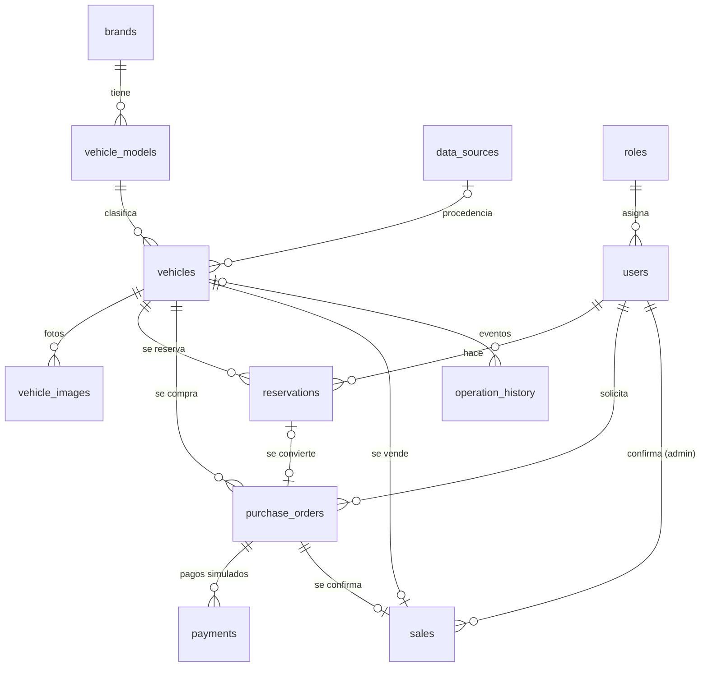

# Modelo de datos de AutoMarket

Base de datos PostgreSQL `automarket`, creada y versionada con Alembic
(`backend/alembic/versions/`). Los modelos SQLAlchemy están en `backend/app/models/`.



## Tablas

| Tabla | Propósito |
|---|---|
| `brands`, `vehicle_models` | Catálogo normalizado (marca → modelo); evita escribir "Honda" de 5 formas distintas |
| `data_sources` | Procedencia de los datos: `real`, `referencia` o `prueba`, con URL y fecha de recopilación |
| `vehicles` | Inventario. Estado `disponible` / `reservado` / `vendido`; borrado lógico con `deleted_at` |
| `vehicle_images` | Fotografías; solo una puede ser la principal |
| `roles`, `users` | Usuarios con su rol: `admin` (AutoMarket.exe) o `cliente` (web) |
| `reservations` | Reservas con vencimiento (`activa`, `cancelada`, `expirada`, `convertida`) |
| `purchase_orders` | Órdenes de compra (`pendiente` → `pagada` → `confirmada`, o `cancelada`) |
| `payments` | Pagos simulados (sin dinero real), `aprobado` / `rechazado` |
| `sales` | Ventas confirmadas por un administrador |
| `operation_history` | Bitácora de negocio legible ("precio actualizado", "reserva cancelada") |
| `audit_log` | Auditoría técnica automática: fila antes/después de cada cambio |

## Reglas que garantiza la propia base de datos

Estas reglas se cumplen aunque falle el código de la aplicación o lleguen dos peticiones al mismo tiempo:

| Regla | Mecanismo |
|---|---|
| Un vehículo no puede tener dos reservas activas | Índice único parcial `WHERE status = 'activa'` |
| Un vehículo no puede tener dos órdenes abiertas | Índice único parcial `WHERE status <> 'cancelada'` |
| Un vehículo solo se vende una vez | `UNIQUE (vehicle_id)` en `sales` |
| Precio > 0, kilometraje ≥ 0, año 1990–2100 | Restricciones `CHECK` |
| Edición simultánea desde la web y el .exe | Bloqueo optimista con `row_version` |
| Todo cambio queda auditado | Trigger `audit_row_change()` en 7 tablas; el autor se toma de `SET LOCAL app.user_id` |
| La auditoría no expone contraseñas | El trigger elimina `password_hash` del JSON |

## Comandos

```powershell
cd backend
.\.venv\Scripts\Activate.ps1
alembic upgrade head      # aplicar migraciones
alembic current           # ver versión actual
alembic downgrade -1      # revertir la última
alembic revision --autogenerate -m "descripcion"   # nueva migración tras cambiar modelos
```
